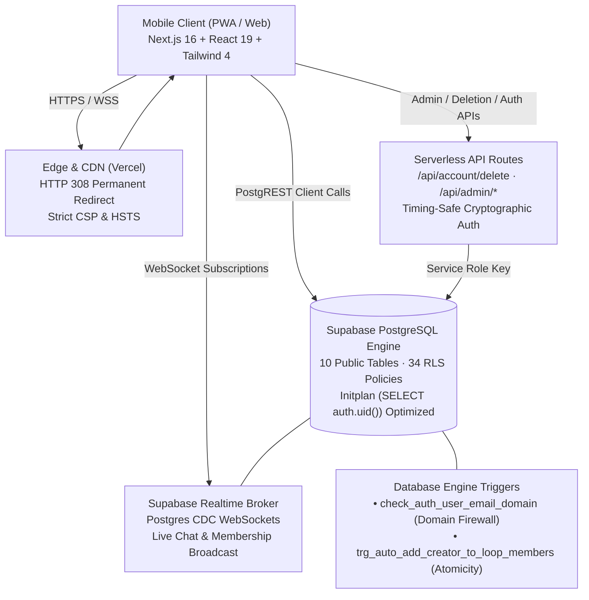

<div align="center">


# LOOP — Coordination Without Friction
### Real-Time, Purpose-Based Campus Mobility for VIT-AP University

[](https://loop-app.runs-on.dev)
[](https://loop-demo-app.vercel.app)
[](https://github.com/sanjaykamal2006/Loop)
[](https://www.typescriptlang.org/)

<br/>

A mobile-first, zero-friction ride coordination platform engineered specifically for **VIT-AP University** students to coordinate shared autos, split fares transparently, and travel safely without WhatsApp group clutter.

</div>

---

## 1. Problem & Architecture

### The Campus Mobility Bottleneck
VIT-AP University is located in Inavolu, roughly 30 km from Vijayawada Junction and Guntur. During peak weekends, exams, and vacations:
- Solo auto fares range from **₹400 to ₹600** per journey.
- Ride requests posted in 1,000+ student WhatsApp groups get buried within seconds.
- Students face fragmented communication, language friction, and unpredictable travel coordination.

### System Architecture Overview



---

## 2. Key Capabilities & Engineering Invariants

- **Atomic Ride Creation:** Built with an engine-level `AFTER INSERT ON loops` trigger (`trg_auto_add_creator_to_loop_members`), ensuring ride creators are enrolled atomically in `loop_members` in a single PostgreSQL transaction with zero client-orchestrated race conditions.
- **Realtime WebSocket Coordination:** Chat messaging and passenger rosters communicate via Supabase Realtime CDC channels with an adaptive 25-second background fallback poll (~88% query reduction over naive polling).
- **Domain-Enforced Authentication Firewall:** Protected by a PostgreSQL `BEFORE INSERT ON auth.users` trigger that validates institutional email addresses (`@vitapstudent.ac.in`) and rejects plus-aliasing (`user+1@...`) directly inside the database engine.
- **Offline SOS Lease Buffer:** Offline fallback system that persists active ride manifests to `localStorage`, allowing passengers to dispatch instant WhatsApp alerts with live GPS coordinates even under poor campus connectivity.
- **Zero-Secret Client Bundles:** All administrative privileges and destructive operations (`/api/account/delete`, `/api/admin/*`) are isolated to serverless routes authenticated via timing-safe token checks (`crypto.timingSafeEqual`).
- **WCAG Mobile Accessibility:** Touch targets across all critical action controls (SOS, Spot, Share) are calibrated to $\ge 44\text{px}$ using zero-visual-shift pseudo hit pads (`before:absolute before:-inset-1.5`). Screen reader updates are announced via `aria-live="polite"` and `role="log"` regions.

---

## 3. Database Schema & RLS Contract

LOOP enforces Row Level Security (RLS) across all 10 public tables using subquery-wrapped identity checks (`(SELECT auth.uid())`) to enable PostgreSQL query planner **InitPlan caching** and prevent per-row execution overhead:

| Table | Purpose | RLS Invariants |
| :--- | :--- | :--- |
| `loops` | Primary ride records (origin, destination, departure, capacity) | Anyone authenticated can read open loops; only creators can update/delete their own rides. |
| `loop_members` | Ride passenger roster and host associations | Members can view co-passengers; atomic trigger auto-enrolls creator; members can leave. |
| `messages` | Realtime group chat records | Restricted strictly to enrolled members of that specific ride loop. |
| `profiles` | Student profile (display name, reg number, gender, avatar) | Public read for authenticated students; update restricted to profile owner. |
| `allowed_external_emails` | Whitelist for special non-institutional guest users | Admin-only write; authenticated read during auth validation. |
| `emergency_contacts` | Personal emergency contacts for SOS dispatch | Strictly private to the contact owner. |
| `trusted_vehicles` | Saved trusted auto / cab drivers | Community-accessible for verified ride coordination. |
| `expected_fares` | Landmark fare reference database | Read-only reference table for auto fare calculations. |
| `profile_contacts` | Shared contact preferences | Owner-restricted update. |
| `loop_participants` | Legacy backward-compatibility view | Synced with `loop_members`. |

---

## 4. API Reference

All server-side API endpoints are located under `src/app/api/`:

### `GET /api/keep-alive`
- **Purpose:** Verifies operational readiness and measures PostgreSQL round-trip latency.
- **Response:** `200 OK` $\rightarrow$ `{"status":"healthy","message":"Database connection ping successful","durationMs":...}`

### `POST /api/auth/validate-email`
- **Purpose:** Pre-validates student email addresses prior to OTP dispatch.
- **Payload:** `{"email": "student.reg@vitapstudent.ac.in"}`
- **Security:** Rejects plus-addressing (`+`), validates domain suffix, and cross-checks `allowed_external_emails`.

### `POST /api/account/delete`
- **Purpose:** GDPR / DPDP-compliant irrevocable account decommissioning.
- **Headers:** `Authorization: Bearer <user_session_token>`
- **Logic:** Decommissions hosted rides, dispatches tombstone notices to active passenger chats, scrubs storage avatars, and deletes auth record via Service Role.

### `GET /api/admin/stats`
- **Purpose:** Administrative health dashboard metrics.
- **Headers:** `Authorization: Bearer <CRON_SECRET | SUPABASE_SERVICE_ROLE_KEY>`
- **Security:** Verified with byte-length pre-check and `crypto.timingSafeEqual`.

### `POST /api/admin/sync-whitelist`
- **Purpose:** Bulk synchronize approved guest email accounts.
- **Headers:** `Authorization: Bearer <CRON_SECRET>`

### `GET /api/cleanup`
- **Purpose:** Automated cron maintenance to expire completed loops and archive past chats.

---

## 5. Security & Content Security Policy (CSP)

LOOP deploys strict HTTP response headers configured in [`next.config.ts`](./next.config.ts):

```http
Content-Security-Policy: default-src 'self'; script-src 'self' 'unsafe-inline'; style-src 'self' 'unsafe-inline'; img-src 'self' data: blob: https://*.supabase.co https://api.qrserver.com; media-src 'self'; font-src 'self' data:; connect-src 'self' https://*.supabase.co wss://*.supabase.co; object-src 'none'; frame-ancestors 'none'; base-uri 'self'; form-action 'self' https://wa.me;
Strict-Transport-Security: max-age=31536000; includeSubDomains; preload
X-Frame-Options: DENY
X-Content-Type-Options: nosniff
Referrer-Policy: strict-origin-when-cross-origin
Permissions-Policy: camera=(), microphone=(), geolocation=(self)
```

- **Audio Asset Hardening:** Internalized notification chime synthesized directly via the Web Audio API (`AudioContext`), eliminating external media CDN dependencies.
- **Timing-Safe Crypto:** All administrative and webhook bearer tokens are verified using `crypto.timingSafeEqual`.
- **Zero-Trust Client Bundling:** Service role keys and database connection strings are never exposed to browser bundles.

### Observability & Diagnostics
- **Server Runtime:** Structured JSON log output for Vercel and Node serverless functions.
- **Client Runtime:** Local 20-entry circular diagnostic buffer (`getDiagnosticLogs()`) and crash persistence in `sessionStorage["loop_last_crash"]`.
- **Forensic Triage:** Diagnostic history inspectable via `window.__LOOP_DIAGNOSTICS__()` and rendered in the `ErrorReporter` debug panel.
- **Pluggable Telemetry:** Extensible handler registration via `logger.registerTelemetryHandler()` for external monitoring services.

---

## 6. Development & Verification Guide

### Prerequisites
- Node.js 20+
- npm 10+
- Supabase Project or local Docker CLI

### Setup
```bash
git clone https://github.com/sanjaykamal2006/Loop.git
cd Loop/Loop-App-2-codebase
npm ci
npm run verify:deps
cp .env.example .env
```

### Running the Test Suite
```bash
# Verify dependency tree integrity (guards against undeclared/phantom peer dependencies)
npm run verify:deps

# Run 124 unit, component, and API integration tests
npm run test:run

# Run read-only database schema & RLS contract tests against live instance
$env:TEST_DATABASE_URL="postgresql://..."; npm run test:db

# Run linter
npm run lint

# Run optimized Next.js 16 Turbopack production build
npm run build
```

---

## 7. Tech Stack

- **Framework:** Next.js 16 (App Router, Turbopack)
- **Runtime:** React 19, TypeScript (Strict 0 `any` types)
- **Database & Realtime:** Supabase (PostgreSQL 15, RLS, WebSockets)
- **Styling:** Tailwind CSS 4, Lucide React
- **Testing:** Vitest, Testing Library, Jest DOM
- **Deployment:** Vercel Edge Network (`loop-app.runs-on.dev`)

---

<div align="center">


### Engineered by Sanjay Kamal S
*Creator of LOOP • VIT-AP University*

[](https://openinapp.link/si31z)
[](https://linkedin.openinapp.co/djr8q)
[](https://insta.openinapp.co/uekq6)
[](mailto:loopdeveloper8@gmail.com)

</div>
